# KIẾN TRÚC HỆ THỐNG: TIỀN XỬ LÝ DỮ LIỆU & TRÍCH XUẤT ĐẶC TRƯNG

> **Tài liệu đặc tả kiến trúc phần mềm (Giai đoạn 1: Xử lý Dữ liệu & Trích xuất Đặc trưng)**  
> **Đề tài:** Machine Learning trong Phát Hiện URL Phishing  
> **Phương pháp tiếp cận:** Lập trình hướng đối tượng (OOP), Nguyên lý SOLID & Các mẫu thiết kế (Design Patterns).

---

## 1. Cấu Trúc Thư Mục Dự Án (Project Structure)

Giai đoạn hiện tại tập trung toàn bộ vào khâu nạp dữ liệu thô, làm sạch, phân chia tập dữ liệu chống rò rỉ (Domain Leakage) và xây dựng hệ sinh thái trích xuất 40+ đặc trưng số học:

```text
ML trong phát hiện URL Phishing/
├── .gitignore                      # Cấu hình loại trừ file rác, dữ liệu thô lớn và file tạm
├── Architecture.md                 # Tài liệu đặc tả kiến trúc hệ thống và quy trình luồng
├── requirements.txt                # Danh mục các thư viện phụ thuộc của dự án
│
├── Data/                           # Quản lý vòng đời dữ liệu theo 3 cấp độ
│   ├── Raw/                        # Chứa tập URL thô (url, label) tải từ các nguồn Benchmark
│   ├── Interim/                    # Dữ liệu trung gian sau khi làm sạch và chuẩn hóa format
│   └── Processed/                  # Ma trận đặc trưng số học (40+ cột số) xuất ra từ Feature Pipeline
│
├── Models/                         # Lưu trữ mô hình (Giai đoạn sau)
│   └── .gitkeep
│
├── Notebooks/                      # Thử nghiệm, khám phá dữ liệu (EDA) và kiểm thử đặc trưng
│   └── .gitkeep
│
├── Reports/                        # Báo cáo và biểu đồ phân tích dữ liệu
│   └── Figures/
│       └── .gitkeep
│
├── Scripts/                        # Các kịch bản chạy tự động
│   └── run.py                      # Kịch bản thực thi chính (chạy pipeline xử lý dữ liệu và trích xuất đặc trưng)
│
└── Src/                            # Mã nguồn dự án
    ├── Core/                       # Cấu hình, hằng số & Cấu trúc dữ liệu bóc tách URL (Functional / Dataclass)
    │   ├── __init__.py
    │   ├── config.py               # Cấu hình đường dẫn (Pathlib) & thông số thực thi
    │   ├── constants.py            # Hằng số chuẩn (cổng dịch vụ, tập TLD rủi ro, từ khóa nhạy cảm O(1))
    │   └── url_parser.py           # Hàm parse_url() & Dataclass ParsedURL (bóc tách RFC 3986 + PSL)
    │
    ├── Data/                       # Nạp, làm sạch & Phân chia dữ liệu
    │   ├── __init__.py
    │   ├── loader.py               # Class URLDataLoader (Đọc CSV, lọc trùng lặp, chuẩn hóa nhãn 0/1)
    │   └── splitter.py             # Class DomainGroupSplitter (Chia Train/Test theo Registered Domain)
    │
    ├── Features/                   # Hệ thống trích xuất đặc trưng hướng đối tượng (OOP / Strategy Pattern)
    │   ├── base.py                 # Lớp trừu tượng BaseFeatureExtractor(ABC)
    │   ├── lexical.py              # Class LexicalFeatureExtractor (Nhóm 1: 20+ Đặc trưng Từ vựng)
    │   ├── hosting.py              # Class HostingFeatureExtractor (Nhóm 2: 20+ Đặc trưng Máy chủ)
    │   └── pipeline.py             # Class FeaturePipeline (Composite điều phối đơn & hàng loạt)
    │
    ├── Models/                     # Giai đoạn sau (Huấn luyện & Đánh giá Machine Learning)
    │   └── .gitkeep
    │
    └── App/                        # Giai đoạn sau (Triển khai API & Giao diện Demo)
        └── .gitkeep
```

---

## 2. Biểu Đồ Hoạt Động Xử Lý Dữ Liệu

Biểu đồ thể hiện quy trình khép kín theo chiều ngang từ lúc tiếp nhận tệp dữ liệu thô ban đầu đến khi xuất ra ma trận đặc trưng số học hoàn chỉnh:

```mermaid
flowchart LR
    classDef dataStyle fill:#1e293b,stroke:#0284c7,stroke-width:1.5px,color:#f8fafc;
    classDef processStyle fill:#292524,stroke:#d97706,stroke-width:1.5px,color:#f8fafc;
    classDef featureStyle fill:#14342b,stroke:#059669,stroke-width:1.5px,color:#f8fafc;
    classDef outStyle fill:#2e1065,stroke:#9333ea,stroke-width:1.5px,color:#f8fafc;

    RawCSV["Tập URL Thô<br>(Data/Raw/*.csv)"]:::dataStyle
    Loader["URLDataLoader<br>• Lọc rỗng, duplicate<br>• Chuẩn hóa nhãn 0/1"]:::processStyle
    InterimCSV[("Dữ liệu sạch<br>(Data/Interim)")]:::dataStyle
    Splitter["DomainGroupSplitter<br>Group Split theo Domain<br>(Chống rò rỉ Data Leakage)"]:::processStyle

    TrainSet["Tập Train URLs"]:::dataStyle
    TestSet["Tập Test URLs"]:::dataStyle

    Pipeline["FeaturePipeline<br>Điều phối đa tiến trình"]:::processStyle
    Parser["parse_url()<br>ParsedURL (RFC 3986 + PSL)"]:::processStyle

    Lexical["LexicalFeatureExtractor<br>Nhóm 1: 20+ Đặc trưng Từ vựng"]:::featureStyle
    Hosting["HostingFeatureExtractor<br>Nhóm 2: 20+ Đặc trưng Máy chủ"]:::featureStyle

    Assembler["Tổng hợp Ma trận<br>40+ Cột Đặc trưng"]:::processStyle

    MatrixTrain[("Ma trận Train 40+ số<br>(Data/Processed)")]:::outStyle
    MatrixTest[("Ma trận Test 40+ số<br>(Data/Processed)")]:::outStyle

    RawCSV --> Loader
    Loader --> InterimCSV
    InterimCSV --> Splitter
    Splitter --> TrainSet
    Splitter --> TestSet

    TrainSet --> Pipeline
    TestSet --> Pipeline

    Pipeline --> Parser
    Parser --> Lexical
    Parser --> Hosting

    Lexical --> Assembler
    Hosting --> Assembler

    Assembler --> MatrixTrain
    Assembler --> MatrixTest
```


