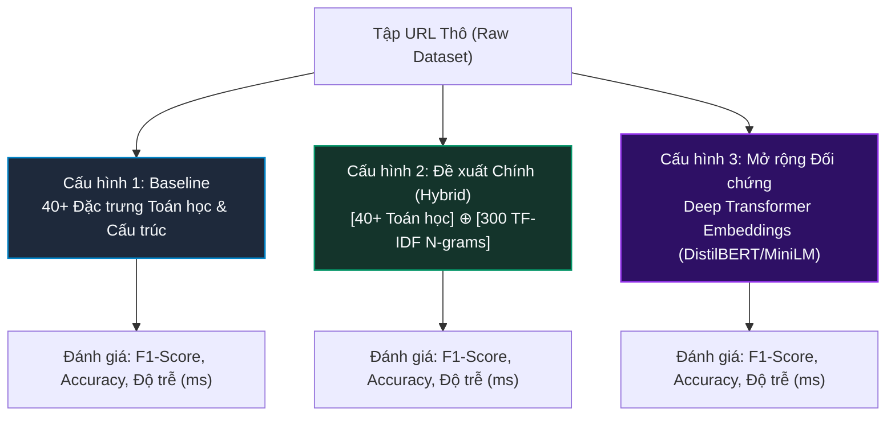

# KẾ HOẠCH NGHIÊN CỨU & LỘ TRÌNH PHÁT TRIỂN (RESEARCH & IMPLEMENTATION PLAN)

> **Đề tài:** Machine Learning trong Phát Hiện URL Phishing  
> **Tài liệu tham chiếu:** [`Document/NCKH.md`](file:///d:/ML%20trong%20ph%C3%A1t%20hi%E1%BB%87n%20URL%20Phishing/Document/NCKH.md), [`Architecture.md`](file:///d:/ML%20trong%20ph%C3%A1t%20hi%E1%BB%87n%20URL%20Phishing/Architecture.md)  
> **Cập nhật lần cuối:** 2026-11-22  

---

## 1. Bản Chất Quy Trình Dữ Liệu & Bài Toán Machine Learning

1. **Bảo toàn Nhãn gốc ($y$ - Ground Truth):**
   * Nhãn phân loại (`label`: 0 - Lành tính, 1 - Phishing) được **bảo toàn nguyên vẹn 100% từ tập dữ liệu thô (Raw Dataset)** như PhiUSIIL hoặc Kaggle.
   * Tuyệt đối không sử dụng bất kỳ luật cứng (heuristic rule/port check) nào để tự ý thay đổi hoặc gán lại nhãn dữ liệu.
2. **Bản chất của Trích xuất Đặc trưng ($X$):**
   * Các thuật toán Machine Learning dạng bảng (Random Forest, XGBoost, LightGBM) chỉ làm việc trên ma trận số học.
   * Khâu trích xuất đặc trưng có nhiệm vụ đo đạc các thuộc tính toán học, cấu trúc và ngữ nghĩa trên chuỗi văn bản `url` thô để sinh ra vector số học $X$.
   * Ma trận đầu ra tại `Data/Processed/` sẽ ghép nối các cột đặc trưng $X$ với cột `label` gốc làm cơ sở huấn luyện.
3. **Vai trò của `Src/Core/constants.py`:**
   * Là điểm lưu trữ tập trung các tập hợp hằng số đối chiếu toán học được định nghĩa trong `NCKH.md`:
     * $\mathcal{D}_{\text{ports}} = \{80, 443\}$: Nhận diện cổng dịch vụ chuẩn.
     * $\mathcal{D}_{\text{risky}}$: Danh sách TLD có tỷ lệ lạm dụng cao (theo báo cáo Spamhaus).
     * $\mathcal{D}_{\text{shortener}}$: Danh sách các nhà cung cấp dịch vụ rút gọn link (`bit.ly`, `tinyurl`, ...).
     * $\mathcal{D}_{\text{brand}}$ & $\mathcal{D}_{\text{sensitive}}$: Danh sách thương hiệu hay bị mạo danh và từ khóa tâm lý lừa đảo.
   * Khai báo dưới dạng `Set` để đạt tốc độ tìm kiếm tức thì $O(1)$.

---

## 2. Phân Tích So Sánh Các Hướng Tiếp Cận Trích Xuất Đặc Trưng

| Hướng tiếp cận | Cơ chế hoạt động | Ưu điểm cốt lõi | Nhược điểm & Hạn chế | Khả thi tài nguyên (Hardware) |
| :--- | :--- | :--- | :--- | :--- |
| **Hướng 1: Đặc trưng Toán học & Cấu trúc (Handcrafted Lexical & Structural)** | Đo độ dài, đếm tần suất ký tự, tính Shannon Entropy, phân tích RFC 3986 + PSL (40+ đặc trưng trong `NCKH.md`). | • Tốc độ siêu nhanh ($< 0.1$ ms / URL). • Rất nhạy với dị thường cấu trúc: IP thô, cổng lạ, Punycode `xn--`, chuỗi DGA ngẫu nhiên. | • **Mù ngữ nghĩa (Semantic Blindness):** Dễ bị qua mặt bởi URL có cấu trúc đẹp nhưng ghép từ mạo danh tinh vi (`secure-login-vietcombank-verify.com`). | Rất nhẹ, chạy hoàn toàn trên CPU thông thường. |
| **Hướng 2: Character N-grams kết hợp TF-IDF** | Băm nhỏ URL thành các cụm $N$ ký tự liên tiếp ($N \in [3, 5]$). Tính trọng số TF-IDF cho từng n-gram. | • **Bắt cực chuẩn Typosquatting:** Dù đổi `paypal` thành `paypa1`, các n-gram con (`pay`, `ayp`, `ypa`) vẫn khớp. • Kháng lỗi từ ngoài từ điển (OOV). | • Tạo ma trận số chiều lớn (cần kiểm soát bằng `max_features = 300 - 500`). • Chưa hiểu sâu ngữ cảnh thứ tự xa. | Nhẹ, xử lý nhanh trên CPU bằng `scikit-learn`. |
| **Hướng 3: Mô hình Ngôn ngữ & Transformer (NLP / Embeddings)** | Xem URL như câu văn, dùng FastText hoặc Transformer (DistilBERT, MiniLM / URLBERT) với cơ chế Self-Attention. | • **Hiểu sâu ngữ cảnh và ý định:** Nhận diện mối liên kết giữa Brand + Action Keyword (`bank` + `verify`). • Không cần kỹ nghệ đặc trưng thủ công. | • Độ trễ suy luận cao ($10 - 50$ ms / URL). • Đòi hỏi GPU để huấn luyện. • Dễ bị rối trước các mã hóa cấu trúc mạng (IP số nguyên, Hex). | Nặng, bắt buộc cần GPU (Google Colab / Dedicated GPU). |

---

## 3. Chiến Lược Thực Nghiệm Đề Tài NCKH (Ablation Study)

Để bài nghiên cứu đạt giá trị khoa học cao và thuyết phục tuyệt đối trước hội đồng thẩm định, dự án sẽ triển khai kịch bản thực nghiệm đối chứng theo 3 cấu hình:

1. **Mô hình 1 (Baseline - Nền tảng):**
   * Chỉ sử dụng 40+ đặc trưng toán học và cấu trúc theo `NCKH.md`.
   * Mục tiêu: Đạt baseline tốc độ cao, tái lập các kết quả benchmark truyền thống.
2. **Mô hình 2 (Đề xuất chính - Kiến trúc Lai Hybrid):**
   * Kết hợp: **[40+ Đặc trưng Toán học]** $\oplus$ **[300 Đặc trưng TF-IDF Character N-grams]** $= \mathbf{340\text{ chiều số}}$.
   * Thuật toán phân loại: **XGBoost / LightGBM**.
   * Mục tiêu: Bù đắp hoàn hảo điểm mù ngữ nghĩa của Mô hình 1, bắt triệt để lỗi chính tả typosquatting trong khi vẫn giữ tốc độ xử lý nhanh ($< 0.5$ ms) trên CPU.
3. **Mô hình 3 (Mở rộng đối chứng - Deep Learning / Transformer):**
   * Trích xuất vector đặc trưng bằng Transformer rút gọn (DistilBERT / MiniLM) trên môi trường Google Colab GPU.
   * Mục tiêu: Cung cấp số liệu so sánh toàn diện trong bài báo khoa học: chứng minh mô hình Hybrid (Mô hình 2) đạt sự cân bằng tối ưu nhất giữa độ chính xác và chi phí tài nguyên tính toán thực tế.

---

## 4. Lộ Trình Triển Khai Kỹ Thuật (Implementation Roadmap)

### Giai đoạn 1: Chuẩn hóa Nền tảng & Tiền Xử Lý Dữ Liệu
- [ ] Thiết lập tệp [requirements.txt](file:///d:/ML%20trong%20ph%C3%A1t%20hi%E1%BB%87n%20URL%20Phishing/requirements.txt) (`pandas`, `numpy`, `tldextract`, `scikit-learn`, `joblib`).
- [ ] Xây dựng `Src/Core/constants.py` định nghĩa các tập hợp hằng số $\mathcal{D}$.
- [ ] Xây dựng `Src/Core/config.py` cấu hình đường dẫn thư mục `Data/`.
- [ ] Xây dựng `Src/Core/url_parser.py` (Hàm `parse_url()` trả về Dataclass `ParsedURL` chuẩn RFC 3986 + PSL).
- [ ] Xây dựng `Src/Data/loader.py` (`URLDataLoader`) nạp và chuẩn hóa dữ liệu thô.
- [ ] Xây dựng `Src/Data/splitter.py` (`DomainGroupSplitter`) phân chia Train/Test theo Registered Domain chống rò rỉ dữ liệu.

### Giai đoạn 2: Hệ Thống Trích Xuất Đặc Trưng Hướng Đối Tượng (OOP)
- [ ] Xây dựng `Src/Features/base.py` (Lớp trừu tượng `BaseFeatureExtractor(ABC)`).
- [ ] Xây dựng `Src/Features/lexical.py` (`LexicalFeatureExtractor` - 20+ đặc trưng từ vựng).
- [ ] Xây dựng `Src/Features/hosting.py` (`HostingFeatureExtractor` - 20+ đặc trưng máy chủ).
- [ ] Xây dựng `Src/Features/ngram_tfidf.py` (`NGramTfidfExtractor` - 300 đặc trưng N-gram ký tự).
- [ ] Xây dựng `Src/Features/pipeline.py` (`FeaturePipeline` - Composite điều phối đơn lẻ và chạy song song đa tiến trình).

### Giai đoạn 3: Thực Thi Pipeline & Xuất Ma Trận Số Học
- [ ] Hoàn thiện `Scripts/run.py` đọc dữ liệu từ `Data/Raw/`, thực thi pipeline và xuất ra:
  * `Data/Processed/train_features.csv`
  * `Data/Processed/test_features.csv`
- [ ] Kiểm thử tính đúng đắn của ma trận đặc trưng (không có giá trị NaN/Inf, đúng kiểu dữ liệu số học).

### Giai đoạn 4: Huấn Luyện, Đánh Giá & Báo Cáo Khoa Học (Giai đoạn tiếp theo)
- [ ] Huấn luyện các mô hình Machine Learning (Random Forest, XGBoost, LightGBM).
- [ ] Đánh giá các chỉ số: Precision, Recall, F1-Score, ROC-AUC và Độ trễ suy luận (Inference Latency).
- [ ] Lập bảng so sánh đối chứng (Ablation Study) hoàn thiện báo cáo đề tài.
